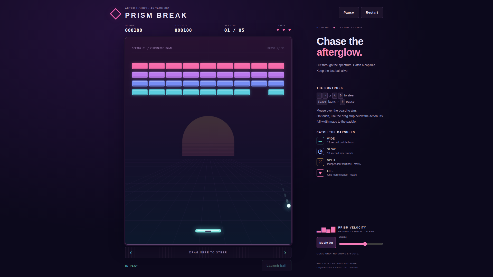

# Prism Break — private preparation

**Not published or cleared for release.** Existing art, five formations, soundtrack and `prism-break.*` records/preferences are retained. Proposed branding/URL is confined to `docs/private-migration.md`. Historical screenshots and verification records below are not new preparation results; see `/root/arcade-migration-audit/preparation/brick-*` for current execution evidence.

Local review: `npm ci`, `npm run serve`, open `http://127.0.0.1:4279`. Stop a manual server before running `BASE_URL=http://127.0.0.1:4279 npm run test:browser` (all three browser projects). Unit tests: `npm test`. There is no build command. In this shared audit environment each server/test must run inside `flock /root/arcade-migration-audit/preparation/test.lock`. Install browsers with `npx playwright install --with-deps chromium firefox webkit` if necessary. Do not publish the repository root; runtime files are `index.html`, `style.css`, `src/`, `assets/prism.svg` plus the MIT `LICENSE`, not tests, evidence or migration docs.

An original synthwave brick breaker: five handcrafted prism formations, a dusk-lit vector arena, and an original instrumental soundtrack. Static HTML, CSS, Canvas and vanilla JavaScript ES modules; no backend, ads or paid services.

## Play

Start a run, then press Space or tap Launch ball. Clear every brick to continue to the next sector. Break all five for Victory. Armored bricks take two or three hits; their pips show remaining strength. Each hit earns 25 points while each destroyed brick earns 100. You start with three lives; only losing the last active ball costs a life.

- Desktop: Left/Right or A/D steer; mouse over the board also aims. Space launches; P or Escape pauses/resumes. Visible Pause/Resume and Restart buttons are always available.
- Mobile: drag the dedicated strip below the board. Its full width maps directly to board coordinates, keeping your finger below the action. Tap Launch ball after each serve. Portrait and landscape preserve the game and soundtrack.
- Capsules: ↔ wide paddle for 12 seconds; ◷ slow balls for 10 seconds; ⁙ independent multiball (five-ball cap); ♥ extra life (five-life cap). Every fifth destroyed brick drops a capsule, cycling through the four types. Temporary effects refresh, never compound, and reset at a new sector, lost last ball or restart. Capsules never delay completion.
- Hidden tabs automatically pause the game. Returning does not automatically resume gameplay. The record is saved locally when available; storage failure does not block play.

## Music

“Prism Velocity” is an original 156-BPM A-minor synthwave instrumental: a rising/falling saw-and-triangle hook, octave bass, stereo chord stabs, syncopated pulse and stable synthesized musical percussion. There are no sound effects of any kind. The 16-bar score and synthesis live in [src/music.js](src/music.js); code, artwork and composition use the MIT license.

One AudioContext and one continuous loop are created only after interaction. Start, restart, pause, menus, gameover, victory, resize and orientation never restart the transport. Music On/Off fades master gain while preserving phase. Volume and enable preferences use Prism-specific localStorage keys. Hidden pages can suspend/resume the same context. Read-only diagnostics: `window.prismAudio.snapshot()` and `.measure()`. [Music comparison and provenance](docs/music-provenance.md).

## Run locally

Requires Node.js 22. npm dependencies are local to this project.

    npm ci
    npm run serve

Open http://127.0.0.1:4279/ (or set PORT for the local server). All game asset URLs are relative, including under a GitHub Pages repository subpath.

## Tests

    npm test
    npx playwright install --with-deps chromium firefox webkit
    npm run test:browser

Vitest tests deterministic rules, geometry, lifecycle, pickups, storage and music abstraction. `node scripts/reachability.js` additionally exercises all five layouts using an automated mouse-style paddle tracker without deleting bricks or modifying score/lives; this is a reachability experiment, not a human-skill claim. Playwright exercises real startup, inputs, layouts, progression, highscore persistence and real Web Audio rendering across Chromium, Firefox and WebKit, one worker. Linux Firefox requires a working audio service (for headless servers, start PulseAudio with a null sink); the tests do not fake AudioContext rendering. Mutating scenario hooks require BOTH localhost and `?test=1`; production exposes read-only snapshots only.

CI uses npm ci and runs both suites on push to main and pull requests. [Verification evidence and limitations](docs/verification.md). Automated mobile tests are emulation, not physical-device touch or subjective speaker/listening verification. No claim of universal 60 FPS is made; physics uses a fixed 120-Hz step with ≤2-pixel collision substeps, independent of rendering.

## Structure

- src/rules.js — deterministic campaign and collision rules
- src/app.js — Canvas rendering, responsive UI and input
- src/music.js — original score, stereo synthesis and persistent transport
- src/storage.js — optional safe persistence
- tests/ — Vitest and Playwright regressions

[Live game](https://nateofspades.github.io/breakout_game/) · [MIT license](LICENSE)
